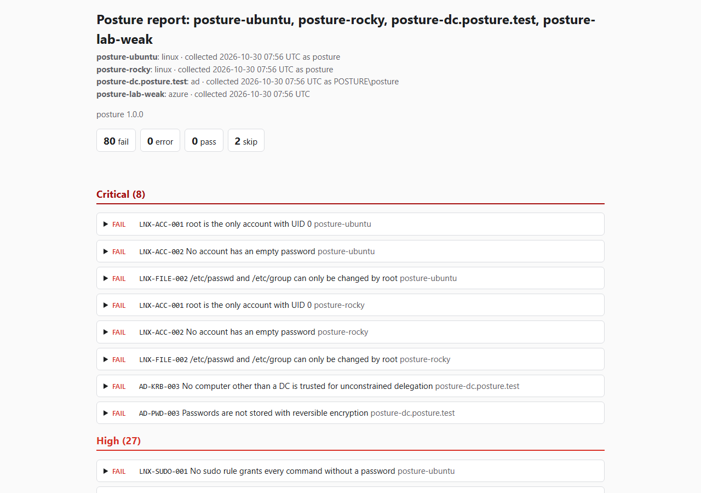
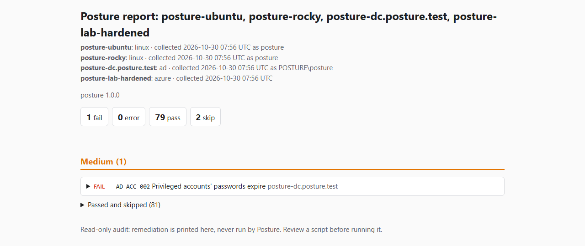
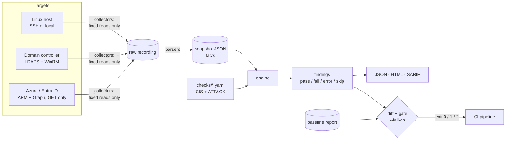

# Posture

[](https://github.com/Shamonzen/posture/actions/workflows/ci.yml)

Read-only security posture auditor for **Linux hosts** (Ubuntu 24.04, Rocky Linux 9), **Windows
Server + Active Directory**, and **Azure / Entra ID**. 56 checks, each mapped to a CIS benchmark
control (where one exists) and to the MITRE ATT&CK techniques the misconfiguration enables, with
a fix printed next to it. Reports as JSON, HTML and SARIF, with a baseline diff and a severity
gate for CI.

## The problem

The infrastructure a security engineer owns spans three layers: the hosts, the directory that
controls who can log on to them, and the cloud tenant around them. Each layer has its own
auditing tool, its own report format and its own idea of severity, so "how exposed are we, and
did last week's change make it better or worse?" has no single answer.

Posture audits all three into one data model and one report. Every finding says what is wrong,
which attacker technique it opens up, and how to fix it. Posture never changes the system it
audits: it only reads, with the least privilege each read needs, and remediation is text in the
report.

## Before / after

The same lab (two Linux VMs, a domain controller, and a recorded Azure tenant), audited with its
weak profile and then its hardened profile: **80 failing findings → 1**.

| Weak profile | Hardened profile |
|---|---|
| [](docs/reports/before.html) | [](docs/reports/after.html) |

Full reports: [`docs/reports/before.html`](docs/reports/before.html),
[`docs/reports/after.html`](docs/reports/after.html). The one finding left on the hardened lab
is real: Vagrant's own `vagrant` admin account keeps a non-expiring password because Vagrant
logs on with it.

## How it works



- **Collect** reads a system into a snapshot of facts. Linux runs a fixed allowlist of commands
  (argument lists, no shell, nothing collected ever goes into a command). AD uses a fixed list
  of LDAP searches over LDAPS on a read-only connection, plus one fixed `Get-Item` script per
  registry key over sealed WinRM. Azure makes 10 fixed GET requests; the HTTP client refuses
  any other method before it is sent. Raw output can be recorded and replayed.
- **Evaluate** runs the checks over a snapshot. Checks are data: one YAML entry each, validated
  by a strict schema, holding a fact, an operator and a value (or `for_each` / `where` over a
  list). Logic that needs code (decoding `userAccountControl`, expanding nested groups,
  deciding whether Conditional Access really enforces MFA) lives in tested parsers, as derived
  facts.
- **Report**: a fact that could not be collected makes its check `error`, never a silent pass,
  and errors fail the CI gate. Findings carry a fingerprint, so a baseline of accepted findings
  survives re-runs and `posture diff` shows what is new, fixed or unchanged.

## Quick start

Python 3.12 and [uv](https://docs.astral.sh/uv/). No lab or cloud account is needed to try
it: the committed lab recordings replay offline.

```bash
git clone https://github.com/Shamonzen/posture.git && cd posture
uv sync --all-extras

# One recorded host, HTML report
uv run posture audit linux --replay tests/fixtures/recordings/ubuntu-weak --html out/report.html

# The whole recorded lab in one report, failing on anything high or worse
uv run posture audit --inventory tests/fixtures/inventories/lab-weak.yaml \
  --html out/lab.html --sarif out/lab.sarif --json out/lab.json --fail-on high
```

Against real systems:

```bash
# Linux: this host, or one over SSH (the system ssh client and your keys)
uv run posture audit linux --local --html out/me.html
uv run posture audit linux --ssh web01 --html out/web01.html

# Active Directory: LDAPS with the DC certificate verified, plus DC registry over WinRM
# (password from POSTURE_LDAP_PASSWORD or a prompt)
uv run posture audit ad --ldap dc01.corp.example --user 'EXAMPLE\posture' --winrm --html out/ad.html

# Azure: credentials from the environment, a managed identity or az login
uv run posture audit azure --subscription <subscription-id> --html out/azure.html
```

Collection and evaluation can also run apart (`collect` writes a snapshot, `evaluate` reads
one or several), and an inventory file audits several targets into one report:

```bash
uv run posture collect linux --ssh web01 -o out/web01.json
uv run posture evaluate out/web01.json out/dc.json --html out/all.html
uv run posture audit --inventory lab/inventory.yaml --html out/lab.html
```

### CI gate and baseline

```bash
uv run posture audit linux --ssh web01 --json out/after.json \
  --baseline accepted.json --fail-on high
uv run posture diff out/before.json out/after.json
```

| Exit code | Meaning |
|---|---|
| 0 | No `fail` or `error` at or above `--fail-on` (after the baseline) |
| 1 | The gate failed |
| 2 | Usage error, invalid checks, or a target that could not be reached or gave no facts |

The SARIF output (2.1.0) uploads to GitHub code scanning; this repo's own CI gates the hardened
lab recordings at `--fail-on high`, requires the weak ones to fail it, and uploads the weak
SARIF.

### The lab

`lab/` builds the three VMs (VirtualBox + Vagrant, host-only network `192.168.57.0/24`, domain
`posture.test`) with a weak and a hardened profile. Every profile script refuses to run outside
those VMs.

```bash
bash lab/lab.sh up          # posture-ubuntu, posture-rocky, posture-dc
bash lab/lab.sh weak        # or: hardened
bash lab/lab.sh record weak # re-record tests/fixtures/recordings/*-weak
bash lab/lab.sh test        # live audit must match the recordings
```

## Checks

56 checks: 26 Linux, 16 Active Directory, 14 Azure. Each one is a YAML entry in
[`checks/`](checks/) with its rationale, remediation and references. CIS control IDs come from:
CIS Ubuntu Linux 24.04 LTS v1.0.0 (Ubuntu), CIS Red Hat Enterprise Linux 9 v2.0.0 (RHEL, used
for Rocky 9), CIS Microsoft Windows Server 2019 v4.0.0 (WS2019), CIS Microsoft Azure
Foundations v3.0.0 (Azure) and CIS Microsoft 365 Foundations v4.0.0 (M365, for Entra items).
"—" means CIS has no control for it (Kerberoasting, delegation…); the check then cites
Microsoft or ANSSI guidance. Rationales are written for this project, not copied from the
benchmarks. Every check must fail on the weak recording and pass on the hardened one, which a
single parametrized test enforces.

### Linux (Ubuntu 24.04, Rocky 9) (26)

| ID | Check | Severity | CIS | ATT&CK |
|---|---|---|---|---|
| `LNX-ACC-001` | root is the only account with UID 0 | critical | Ubuntu 5.4.2.1, RHEL 5.4.2.1 | T1136.001, T1078.003 |
| `LNX-ACC-002` | No account has an empty password | critical | Ubuntu 7.2.2, RHEL 7.2.2 | T1078.003 |
| `LNX-SUDO-001` | No sudo rule grants every command without a password | high | Ubuntu 5.2.4, RHEL 5.2.4 | T1548.003 |
| `LNX-SUDO-002` | sudo runs commands in a pseudo-terminal | low | Ubuntu 5.2.2, RHEL 5.2.2 | T1548.003 |
| `LNX-SUDO-003` | sudo keeps its own log file | low | Ubuntu 5.2.3, RHEL 5.2.3 | T1548.003, T1070.002 |
| `LNX-FILE-001` | /etc/shadow is owned by root and not readable by everyone | high | Ubuntu 7.1.5, RHEL 7.1.5 | T1003.008 |
| `LNX-FILE-002` | /etc/passwd and /etc/group can only be changed by root | critical | Ubuntu 7.1.1, RHEL 7.1.1 | T1136.001, T1098 |
| `LNX-FILE-003` | sshd_config is owned by root and private | medium | Ubuntu 5.1.1, RHEL 5.1.1 | T1556, T1098.004 |
| `LNX-FILE-004` | No world-writable files outside temporary directories | medium | Ubuntu 7.1.11, RHEL 7.1.11 | T1053.003, T1574 |
| `LNX-FILE-005` | Only expected programs are setuid | medium | Ubuntu 7.1.13, RHEL 7.1.13 | T1548.001 |
| `LNX-FW-001` | ufw is active and denies incoming traffic by default | high | Ubuntu 4.2.3 | T1190, T1021 |
| `LNX-FW-002` | firewalld is running and its zone doesn't accept everything | high | RHEL 4.1.2 | T1190, T1021 |
| `LNX-LOG-001` | auditd is enabled and running | medium | Ubuntu 6.2.1.2, RHEL 6.3.1.4 | T1562.012 |
| `LNX-LOG-002` | Changes to accounts and sudo rules are audited | medium | Ubuntu 6.2.3.8, RHEL 6.3.3.8 | T1136.001, T1098, T1548.003 |
| `LNX-LOG-003` | journald keeps logs across reboots | low | Ubuntu 6.1.2.4, RHEL 6.2.2.4 | T1070.002 |
| `LNX-SSH-001` | SSH root login is disabled | high | Ubuntu 5.1.20, RHEL 5.1.20 | T1110.001, T1078.003 |
| `LNX-SSH-002` | SSH refuses empty passwords | high | Ubuntu 5.1.19, RHEL 5.1.19 | T1078.003 |
| `LNX-SSH-003` | SSH password authentication is disabled | medium | — | T1110.001, T1110.003, T1110.004 |
| `LNX-SSH-004` | SSH allows at most 4 authentication attempts per connection | low | Ubuntu 5.1.16, RHEL 5.1.16 | T1110.001 |
| `LNX-SSH-005` | SSH offers no weak ciphers | medium | Ubuntu 5.1.6, RHEL 5.1.4 | T1557, T1040 |
| `LNX-SSH-006` | SSH offers no weak MACs | medium | Ubuntu 5.1.15, RHEL 5.1.6 | T1557 |
| `LNX-SSH-007` | SSH offers no weak key exchange algorithms | medium | Ubuntu 5.1.12, RHEL 5.1.5 | T1557, T1040 |
| `LNX-SSH-008` | SSH forwarding (X11, agent, TCP) is disabled | medium | Ubuntu 5.1.8, RHEL 5.1.10 | T1572, T1090 |
| `LNX-UPD-001` | No security updates are waiting to be installed | high | Ubuntu 1.2.2.1, RHEL 1.2.2.1 | T1068, T1190 |
| `LNX-UPD-002` | Package metadata was refreshed in the last 7 days | low | — | T1068, T1190 |
| `LNX-UPD-003` | Security updates are installed automatically | medium | — | T1068, T1190 |

### Active Directory and the domain controller (16)

| ID | Check | Severity | CIS | ATT&CK |
|---|---|---|---|---|
| `AD-ACC-001` | No enabled account is allowed an empty password | high | — | T1078.002 |
| `AD-ACC-002` | Privileged accounts' passwords expire | medium | — | T1078.002 |
| `AD-ACC-003` | Privileged groups have at most 3 members | medium | — | T1078.002 |
| `AD-ACC-004` | No enabled account keeps adminCount outside a privileged group | low | — | T1078.002 |
| `AD-LAPS-001` | Every enabled non-DC computer has its admin password managed by LAPS | high | — | T1078.003, T1550.002 |
| `AD-ACC-005` | Ordinary users can't add computers to the domain | medium | — | T1136.002 |
| `DC-SMB-001` | The DC requires SMB signing | high | WS2019 2.3.9.2 | T1557.001 |
| `DC-LDAP-001` | The DC requires LDAP signing | high | WS2019 2.3.5.4 | T1557 |
| `DC-NTLM-001` | The DC accepts NTLMv2 only | high | WS2019 2.3.11.7 | T1557.001, T1110.002 |
| `AD-KRB-001` | No enabled user account has a service principal name | high | — | T1558.003 |
| `AD-KRB-002` | Kerberos pre-authentication is required for every enabled user | high | — | T1558.004 |
| `AD-KRB-003` | No computer other than a DC is trusted for unconstrained delegation | critical | — | T1558, T1550.003 |
| `AD-PWD-001` | Domain passwords are at least 14 characters | high | WS2019 1.1.4 | T1110.001, T1110.003 |
| `AD-PWD-002` | Domain passwords must meet complexity requirements | medium | WS2019 1.1.5 | T1110.001, T1110.003 |
| `AD-PWD-003` | Passwords are not stored with reversible encryption | critical | WS2019 1.1.6 | T1003.006 |
| `AD-PWD-004` | Accounts lock out after at most 5 failed logons | high | WS2019 1.2.2 | T1110.001, T1110.003 |

### Azure and Entra ID (14)

| ID | Check | Severity | CIS | ATT&CK |
|---|---|---|---|---|
| `AZ-GST-001` | Only admins and Guest Inviters can invite guests | medium | Azure 2.16, M365 5.1.6.3 | T1136.003 |
| `AZ-GST-002` | Guests can read only their own directory objects | low | Azure 2.15, M365 5.1.6.2 | T1087.004 |
| `AZ-IAM-001` | MFA is enforced for administrators | high | Azure 2.2.4, M365 5.2.2.1 | T1078.004, T1110.003 |
| `AZ-IAM-002` | Legacy authentication is blocked | high | M365 5.2.2.3 | T1110.003, T1078.004 |
| `AZ-IAM-003` | Every administrator has registered MFA | medium | Azure 2.1.2, M365 5.2.3.4 | T1078.004, T1098.005 |
| `AZ-IAM-004` | Between 2 and 4 principals hold Global Administrator | medium | Azure 2.26, M365 1.1.3 | T1078.004 |
| `AZ-LOG-001` | The subscription Activity Log is exported | medium | Azure 6.1.1 | T1562.008 |
| `AZ-LOG-002` | Microsoft Defender for Cloud plans are on | medium | — | T1562.001 |
| `AZ-NET-001` | No NSG allows RDP from the Internet | high | Azure 7.1 | T1133, T1021.001 |
| `AZ-NET-002` | No NSG allows SSH from the Internet | high | Azure 7.2 | T1133, T1021.004 |
| `AZ-NET-003` | No NSG allows database or WinRM ports from the Internet | high | — | T1133, T1190, T1021.006 |
| `AZ-STG-001` | Storage accounts don't allow anonymous blob access | high | Azure 4.17 | T1530 |
| `AZ-STG-002` | Storage accounts require secure transfer (HTTPS) | medium | Azure 4.1 | T1557, T1530 |
| `AZ-STG-003` | Storage accounts require TLS 1.2 or later | medium | Azure 4.15 | T1557 |

## Permissions

Least privilege per target, detailed in [`docs/permissions.md`](docs/permissions.md):

- **Linux:** a dedicated `posture` user over an SSH key; [`deploy/sudoers.posture`](deploy/sudoers.posture)
  allows exactly the commands that need root, with exact arguments (a test checks it against
  the collector's allowlist).
- **Active Directory:** an ordinary domain user over LDAPS. For the DC registry settings: member
  of *Remote Management Users* (no admin rights) plus read access to one registry key.
- **Azure:** Reader on the subscription and four read-only Microsoft Graph permissions.

A setting these rights can't read is reported as `error` with the reason, and `--fail-on`
treats it as a failure.

## Threat model

The auditor holds strong read credentials and swallows output from systems that may already be
compromised, so it is an attack surface of its own.

| Threat | Mitigation |
|---|---|
| Stored XSS in the report via hostile AD attributes, usernames, Azure resource names | Jinja autoescape, no JavaScript, CSP with `default-src 'none'`, test with hostile fixtures |
| Terminal injection (ANSI / control characters) | Control characters stripped before printing |
| Command injection on the audited host | Fixed command list, argument lists only (no shell), no collected data ever put into a command |
| Hostile or huge output (DoS, ReDoS) | Size caps per command / response, timeouts, simple regexes in parsers |
| Posture used to change systems | Read-only enforced in code (allowlist test, GET-only client, search-only LDAP, fixed `Get-*` scripts) and by the credentials themselves |
| Credential theft from the tool's host | No stored secrets: SSH keys / agent, `.env` for the lab only, `az login` / environment for Azure; nothing written to snapshots or reports |
| MITM during collection | SSH host-key checking stays on; LDAPS with the certificate verified before the bind; WinRM message encryption; HTTPS to Azure, token never sent to another host |
| The report is an attacker's roadmap | Reports and snapshots are sensitive: `out/` is git-ignored, only scrubbed lab recordings are committed, SARIF uploaded only from lab fixtures |
| Remediation scripts run blindly | Printed with a warning to review and test first; never executed by Posture |
| Malicious check files | `yaml.safe_load`, strict pydantic schema (unknown keys rejected), no code in checks |
| Supply chain | `uv.lock` hashes, pip-audit, Bandit, gitleaks, SBOM, Dependabot, SHA-pinned actions |

## Compared with Lynis, PingCastle, Prowler and ScoutSuite

Those are the tools to run in production. Each goes much deeper in its own layer than Posture:

| | Scope | Strength | Not covered |
|---|---|---|---|
| [Lynis](https://cisofy.com/lynis/) | Linux / Unix hosts | Hundreds of tests, hardening index, mature | AD, cloud |
| [PingCastle](https://www.pingcastle.com/) | Active Directory | Trusts, ACLs, GPO risk, scoring: far deeper AD analysis | Hosts, cloud; Windows / .NET only |
| [Prowler](https://github.com/prowler-cloud/prowler) | AWS, Azure, GCP, M365, Kubernetes | Hundreds of checks, many compliance frameworks | Hosts, on-prem AD |
| [ScoutSuite](https://github.com/nccgroup/ScoutSuite) | Multi-cloud | Offline HTML configuration review | Hosts, AD |
| **Posture** | Linux, AD + DC, Azure / Entra | One data model and report across all three layers, ATT&CK on every finding, CI-native (SARIF, baseline, gate), recorded lab for offline tests | Far fewer checks than any of them |

For coverage, run Prowler + PingCastle + Lynis. Posture shows what those tools check and why,
and how to wire posture auditing into a pipeline.

## Design decisions

- **Checks as YAML data, not Python (or Rego).** Reviewable by non-developers, diffable, safe to
  load, and one generic test proves every check. A small operator language has a ceiling, so
  the hard logic lives in parsers as tested derived facts and checks stay comparisons. Rego
  would be the upgrade if the operator set keeps growing.
- **Collect / evaluate split with record and replay.** Tests run offline and deterministically
  on real lab data, snapshots are audit evidence, old snapshots can be re-evaluated with new
  checks, and collection can run where the credentials are. The cost: snapshots are as
  sensitive as reports, and recordings drift as OS versions change, so they are re-recorded
  from the lab.
- **Read-only and least privilege, with honest gaps.** Some settings can't be read without
  admin rights; those checks say `error` and why, and CI fails closed on them. Upgrade path: a
  JEA endpoint on the DC.
- **LDAPS + simple bind, not signed LDAP.** The released `ldap3` can't sign or seal a bind, and
  its NTLM fails on Python 3.12 / OpenSSL 3. LDAPS with the certificate (and its IP SAN)
  checked before any credential is sent was the smallest safe option.
- **SARIF for infrastructure findings.** Code scanning needs a file location, so a host finding
  points at its check's YAML line. A known compromise; `error` results stay out of SARIF (no
  "unknown" state there) but still fail the gate.

The full plan, with what the real lab showed at each milestone, is in
[`docs/PLAN.md`](docs/PLAN.md).

## Limitations

- Point-in-time audit, not continuous monitoring; drift between runs shows only through `diff`.
- Effective vs configured state: Posture reads effective settings where it can (`sshd -T`, the
  DC's registry), but GPOs not yet applied, or other DCs, are not seen; one DC is audited.
- Pending updates are as fresh as the host's package cache (Posture never refreshes it), and a
  kernel updated but not yet rebooted into is not flagged.
- Conditional Access is evaluated structurally (enabled, targets admins, requires MFA), not by
  simulating sign-ins. NSG exposure ignores a higher-priority Deny for the same port.
- Not checked yet: stale accounts, krbtgt password age, group membership through
  `primaryGroupID` or beyond 1 500 `member` values.
- Targets are audited one after another, not in parallel.
- 56 checks: a fraction of any full CIS benchmark.

## Development

```bash
uv sync --all-extras
uv run ruff check . && uv run ruff format --check .
uv run pytest           # replays the recordings; no lab or cloud needed
bash lab/lab.sh test    # pytest -m lab, against the running lab
```

Layout: `src/posture/collectors/` (read-only transports), `parsers/` (raw output → facts),
`engine.py` + `checks/` (YAML checks), `reports/` (JSON, HTML, SARIF), `baseline.py` (diff and
gate), `lab/` (Vagrant lab and profiles), `tests/fixtures/recordings/` (scrubbed lab
recordings). Changes are listed in [`CHANGELOG.md`](CHANGELOG.md).

## License

MIT, see [LICENSE](LICENSE).
